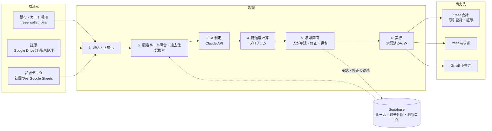

# 結乃社 AI経理MVP 技術設計書

2026-10-05 · Ken

> この文書は Claude Docs 上の原本（https://claude.ai/code/artifact/23c1029c-a5d9-4a14-8fbd-6c64c850ff37 、rev 17）を Markdown に写したものです。原本の図（システム構成図・開発スケジュール）は埋め込み図のため、本文の説明から書き起こした図または注記に置き換えています。設計の変更は原本とこのファイルの両方に反映してください。

## 結論

推奨は「Next.js（Vercel）＋Supabase＋Claude API＋freee API＋Gmail API」を1つのリポジトリで組む構成です。n8nとOpenAIはMVPでは使いません。

- **構成**: アプリ1つ、DB1つ、AI1社。処理ロジックはすべてコードに置き、テストとログを一か所に集めます。
- **AIの役割**: Claude Sonnet 5.5が仕訳案の作成と証憑の読取を担当します。過去仕訳の検索はベクトル検索ではなく、取引先名の正規化と文字列の類似度から始めます。
- **安全の要**: AIは提案を返すだけです。freeeへの書込とGmail下書きの作成は、人が承認した後にプログラムが実行します。メール送信は人が行います。
- **開発順序**: 計測とデータ準備 → ① → ⑤ → ③④ → ②。①と⑤は同じ銀行データと承認画面を使うので、早く効果を測れます。
- **期間（概算）**: 全5機能と効果判定まで約16週。①だけなら約10週目に実測できます。前提は開発1名、Claude Code併用、週30時間程度です。
- **費用（概算）**: 固定費は月約7千円、AI利用料は1社あたり月約1千〜2千円です（1ドル150円換算）。
- **最大のリスク**: freee APIで登録した取引が口座明細に自動で消し込まれるかが未確認です。開発初週に実データで検証します。

## 1. MVPシステム構成図

原本の図「MVPシステム構成 · 取込元3つ、処理6段階、出力先3つ」を本文から書き起こしたものです。

データは左から右へ流れ、AIは3の判定だけを担当します。5の承認画面を通ったものだけが6でfreeeやGmailに書き込まれ、承認・修正の結果はSupabaseに蓄積されて次の判定に使われます。

## 2. 使用するAI・API・DB

AIはClaude 1社に絞り、アプリとDBもそれぞれ1つにします。保守する場所を増やさないことを優先しています。

| 用途 | 採用 | 理由 | 採用しないものと理由 |
| --- | --- | --- | --- |
| 仕訳判定・証憑読取 | Claude Sonnet 5.5（API） | 日本語の仕訳判断とPDF・画像の読取を1モデルで賄える。入力$2・出力$10（100万トークンあたり） | OpenAI併用：プロンプト、精度評価、契約管理が2社分に増える |
| 開発 | Claude Code | 1人で開発と保守を回せる | — |
| アプリ（承認画面・バッチ） | Next.js（TypeScript）、Vercelで稼働 | 画面と定期処理を1リポジトリで管理。定期実行はVercel Cron | n8n：ロジックがGUIに分散し、テスト・変更レビュー・ログの統一が難しい |
| DB・ファイル・ログイン | Supabase（Postgres、東京リージョン） | ルール、過去仕訳、ログ、証憑、認証を1つで持てる。行単位の権限（RLS）で顧客を分離 | Google Sheets：権限管理、同時編集、監査ログに弱い |
| 過去仕訳の検索 | 取引先名の正規化＋文字列類似度（アプリ内で計算） | 銀行摘要は短いカナ表記で、意味の近さより表記揺れの吸収が効く | ベクトル検索：精度不足が測定で出たらSupabaseのpgvectorで後付けする |
| 会計・請求書 | freee会計API、freee請求書API | 既存業務がfreee前提 | — |
| メール・証憑の受け取り | Gmail API（下書きのみ）、Google Drive API | 既存のGoogle Workspaceを使う | — |

定型的な判定（ルール一致、金額照合）はプログラムで行い、AIは判断が必要なところだけに使います。料金は[Claudeの料金ページ](https://platform.claude.com/docs/en/about-claude/pricing)で確認した2026年10月5日時点の値です。

## 3. freeeとの連携方法

freeeは「読むのは自動、書くのは承認後だけ」でつなぎます。認証はOAuth 2.0で、結乃社の担当者アカウント（顧客の事業所にメンバー参加済み）で認可し、事業所ID（company_id）で顧客を切り替えます。

| 用途 | 使うAPI | タイミング |
| --- | --- | --- |
| 銀行・カード明細の取得 | GET /api/1/wallet_txns（due_amountで未登録分を判定） | 1日1回の自動取得 |
| 過去仕訳の取込 | GET /api/1/deals、GET /api/1/manual_journals | 初回に過去24か月分、以降は差分 |
| マスタ同期 | account_items、partners、items、sections、tags、taxes/companies | 1日1回 |
| 取引の登録 | POST /api/1/deals（paymentsで口座、receipt_idsで証憑を指定） | 承認後のみ |
| 証憑のアップロード | POST /api/1/receipts | 承認後のみ |
| 請求書の作成 | freee請求書APIの POST /invoices | 承認後のみ |

- **明細CSVの取込**: freee接続と消込検証が済むまでの間も①を試せるよう、銀行・カード会社の明細CSVをアップロードして取り込む経路を先に作ります。wallet_txnsの自動取得は後から同じ明細テーブルに追加し、同じ取引の二重取込は重複キー（口座・日付・入出金・金額・摘要・残高、同じファイル内の連番）で防ぎます。残高がない明細（カードなど）は、別のCSVに入った同日・同額・同摘要の別取引と区別できないため、取込済みと同じキーでも捨てずに「重複の疑い」として登録し、人が「別の取引」か「重複」かを決めます。重複として除外できるのは承認者だけです。取込記録には、読めた行の件数・金額（入金・出金別）と、その内訳（登録・取込済みのため読み飛ばし・重複の疑い）を残し、両者が一致することをDBの制約で確かめます。金額0の行（残高照会など）は取引にせず行番号と理由を残し、読めない行があって取り込まなかったファイルも、理由と行番号を「失敗」の取込記録として残します。取込はDBの関数だけを通し、担当者が明細の表に直接書くことはできません。
- **トークン管理**: アクセストークンは6時間、リフレッシュトークンは90日で使い捨てです。更新のたびに新トークンを暗号化して保存し、同時更新をロックで防ぎます。競合すると連携が切れて再認可が必要になります。
- **呼出し上限**: 事業所×アプリごとに1日3,000回（法人アドバンス5,000回、エンタープライズ10,000回）。月数百件の処理なら十分ですが、初回の過去仕訳取込は数日に分けます。
- **補助科目の扱い**: freeeには独立した補助科目がなく、取引先・品目・部門・メモタグで表します。顧客ルールもこの4つで持ちます。
- **辿れるようにする**: 登録する取引の管理番号（ref_number）にAI判断ログのIDを入れ、freeeとログを双方向に辿れるようにします。
- **未確認点**: 取引作成APIには口座明細のIDを指定する項目がありません。登録した取引で明細が消し込まれるか（due_amountが0になるか）を開発初週に検証します。消し込まれない場合は、AIの候補を見ながらfreee画面で人が登録する形になり、削減効果が下がります。

出典：[freee会計APIスキーマ（公式）](https://github.com/freee/freee-api-schema)、[トークンの有効期限](https://developer.freee.co.jp/reference/faq/token_lifetime)、[freee請求書APIの仕様変更](https://developer.freee.co.jp/news/6658)

## 4. Gmail・Google Driveとの連携方法

Google連携は結乃社のGoogle Workspaceに「内部アプリ」として登録します。内部アプリは社内ユーザーだけが使え、Googleのアプリ審査を受けずに制限付きの権限を使えます（[Googleの説明](https://support.google.com/cloud/answer/13464323)）。

- **Gmail（④請求メール）**: 権限はgmail.composeのみ。請求書PDFを添付した下書きを、請求業務用アカウントに作ります。宛先・件名・本文の雛形は顧客ごとの請求ルールに保存します。
- **送信しない仕組み**: gmail.composeは送信もできる権限なので、権限だけでは送信を止められません。コードに送信処理を一切置かず、レビューで担保します。送信は担当者がGmail画面で行います。
- **Google Drive（②証憑の受け取り）**: 顧客ごとの共有ドライブに「証憑/未処理」フォルダを作り、現場はそこに入れるだけにします。アプリが定期的に取り込み、処理後に「処理済」へ移します。
- **Google Sheets**: ③の請求データを最初に取り込むときだけ使い、以降はアプリの画面で管理します。
- **MVP外**: メールで届く請求書の自動取込（受信メールの読取）は、②が安定してから追加します。

## 5. 顧客別経理ルールの保存方法

ルールは「プログラムが判定できる構造化ルール」と「AIに読ませる文章メモ」の2種類で、どちらもSupabaseに顧客ID付きで保存します。構造化ルールに一致した取引は、AIの推測に頼らず確定的に処理できます。

| テーブル | 中身 | 例 |
| --- | --- | --- |
| 顧客基本情報 | freee事業所ID、決算月、課税方式、インボイス登録の有無、担当者 | 3月決算・簡易課税 |
| マスタの写し | freeeの勘定科目・取引先・品目・部門・メモタグ・税区分 | AIはこの中からしか選べない |
| 仕訳ルール（構造化） | 条件（取引先・摘要の語句・金額帯・口座・入出金）と処理（科目・取引先・品目・部門・税区分・摘要の雛形） | 摘要に「ｱﾏｿﾞﾝ」・出金・5万円未満 → 消耗品費／課税仕入10% |
| 文章メモ | 例外処理、月次処理、注意点を文章で | 代表者カードの私用分は役員貸付金 |
| 請求ルール | 請求先、金額、周期、締日、支払期日、税、メール宛先、特記事項 | 毎月末締め翌月末払い 11万円（税込） |

- **各ルールの属性**: 優先順位、状態（有効・提案中・無効）、作成元（担当者入力・修正履歴からの提案）、作成者、有効期間。
- **変更は上書きしない**: 変更のたび新しい版を作ります。判断ログが「どの版のルールを使ったか」を指せるようにするためです。
- **最初の作り方**: 過去仕訳から「取引先ごとに科目が固定しているもの」を自動抽出してルール候補にし、担当者が確認して有効化します。例外は担当者へのヒアリングで文章メモに残します。

## 6. 過去仕訳の参照方法

過去仕訳は全件をAIに渡さず、取引ごとに「同じ取引先の過去の処理の集計」と「代表例5件」だけを検索して渡します。いわゆるRAGですが、検索はベクトルではなく表記の正規化で行います。

1. **取込**: freeeから過去24か月の仕訳を保存します。銀行の摘要表記とfreee上の取引先を両方持ちます。
2. **正規化**: 全角半角とカナを統一し、法人格の略号（ｶ）、ﾕ）、ｶﾌﾞｼｷｶﾞｲｼｬなど）や日付・番号を取り除いて「取引先キー」を作ります。
3. **検索**: 取引先キーの完全一致 → なければ類似キー（顧客あたり数百件なのでアプリ内で十分速く計算できる）→ なければ「新規取引先」として低確信に回します。金額が近いものを優先します。
4. **渡し方**: 「この取引先は過去23件中22件が通信費／課税仕入10%」のような集計と代表例5件を、関連する顧客ルールと一緒にAIに渡します。
5. **学習**: 承認・修正された結果はその場で過去仕訳に加わり、次の取引から反映されます。同じ修正が3回続いたら「ルール候補」として担当者に提案します。

モデル自体を再学習（ファインチューニング）はしません。データとルールを更新するだけで精度が上がるので、顧客が増えても運用が変わりません。

## 7. AI確信度・Human Approvalの実装方法

確信度はAIの自己申告に頼らず、証拠の強さからプログラムで計算します。AIが自分で「90%自信がある」と言っても、その数字は実際の正答率と一致しないためです。

使う証拠は4つです。

- **ルール一致**: 有効な構造化ルールに一致したか
- **過去一致率**: 同じ取引先の過去仕訳で、科目と税区分が何件中何件一致しているか
- **AIとの一致**: AIの案がルールや過去の多数派と同じか
- **検査**: 科目と税区分の整合、金額が過去の範囲内か、要注意語（返金・立替・前払・個人）がないか

| 確信度 | 条件（初期値） | Phase1の扱い | 実績確認後 |
| --- | --- | --- | --- |
| 高 | ルール一致、または過去5件以上で一致率95%以上。かつAI案が一致し、検査にすべて合格 | 一覧画面でまとめて承認 | 条件を満たした取引パターンだけ自動登録 |
| 中 | 過去の一致はあるが件数が少ない、一致率95%未満、または金額が過去の範囲外 | 1件ずつワンクリックで承認または修正 | 同じ |
| 低 | 新規取引先、AIと過去が不一致、検査不合格、AIが「判断できない」と回答 | 担当者が確認して入力。AIは何がわからないかを明示 | 同じ |

- **ルール一致のときの扱い**: 有効な構造化ルールに一致した取引はAIを呼ばず、ルールの処理をそのまま提案します（5章「AIの推測に頼らず確定的に処理」、13章「ルール一致で確定できる取引はAIを呼ばない」）。このとき「AIとの一致」は求めず、検査に合格すれば高とします。ルールの処理もマスタの写しと照らし、マスタにない値（削除された部門など）があれば提案に使わず低に回して、ルールの見直しを促します。
- **AIが使えないとき**: AIに断られた、形式に合わない回答、マスタにない値を返した場合は提案なしで低に回し、理由を不明点として判断ログに残します。モデルの版を固定するため、別モデルへの自動切替は使いません。
- **常に低に回すもの**: 顧客ごとの上限額以上（初期値30万円）、固定資産になり得るもの、役員や個人が絡むもの。
- **自動化の入口**: 顧客×取引パターン（取引先＋科目）ごとに、直近50件の「高」判定で修正が0件なら自動化候補になります。自動化をオンにするのは人です。閾値は依頼書のとおり、ログを見ながら調整します。
- **AIの出力形式**: 科目・取引先・品目・部門・税区分・摘要・理由・不明点を決められたJSONで返させ、マスタにない値は弾きます。
- **承認画面**: 明細または証憑画像、AIの案、根拠（使ったルールと過去仕訳）を並べ、「承認・修正・保留」をキーボードだけで操作できるようにします。承認・修正・却下は承認者（管理者）だけが行い、担当者は理由を添えて保留にします（DBの関数でも同じ判定をします）。保留は引継ぎなので理由を必須とし（空白だけの理由も拒否）、承認者の画面に保留理由・保留者・日時を表示します。まとめて承認できるのは確信度「高」で保留していない明細だけです。各件の表示から確定までの秒数も記録し、KPIの「人間作業時間」の補助データにします。

## 8. AI判断ログの保存方法

判断ログはSupabaseのテーブルに追記専用で保存し、更新と削除はDBの権限設定で禁止します。依頼書の必須項目はすべて入ります。

| テーブル | 記録する項目 |
| --- | --- |
| AI判断（1取引1行） | 受け取った取引の内容、提案した処理、確信度とその内訳（4つの証拠）、参照したルールと版、参照した過去仕訳のID、AIの理由と不明点、モデル名、プロンプトの版、トークン数と費用、処理日時 |
| 人の確認（1操作1行） | 承認・修正・保留・却下のどれか、修正前後の差分、修正理由（任意）、確認者、確認にかかった秒数、日時 |
| 重複の確認（1操作1行） | 重複の疑いがある明細、同じキーの取込済み明細、「別の取引」か「重複」か、理由（任意）、確認者、日時 |
| 実行（1回の実行1行） | 対応する人の確認のID、実行先（freee取引登録など）、成功・失敗、freee登録結果とそのID、日時 |

- **実行を分ける理由**: freeeへの登録は人の確認の後に起きるため、人の確認の行に後から結果を書き足すと追記専用を守れません。登録結果は実行の行として別に追記し、人の確認のIDで辿ります。DBは「承認」または「修正」の確認がない実行の記録を拒否します。
- **保存期間**: 帳簿書類の保存期間に合わせて最低7年です。1件約10KB、月400件の顧客なら年約50MBなので、50社でも年約2.5GBに収まります（概算）。
- **KPIへの利用**: 自動処理率、人間確認率、修正率、AI提案の正答率は、この2テーブルから自動で集計できます。
- **改善への利用**: 修正された事例は「正解付きテストセット」になります。プロンプトやモデルを変える前にこのセットで正答率を測り、悪化しないことを確認してから切り替えます。

## 9. セキュリティ設計

設計の軸は「AIには何も実行させない」ことです。AIは提案をJSONで返すだけで、freeeやGmailを操作するのは承認後に動く決まったプログラムです。

| 対象 | 対策 |
| --- | --- |
| ログイン | 結乃社のGoogleアカウントでのみログイン可（自社ドメイン限定、2段階認証必須） |
| 閲覧範囲 | 担当顧客のデータだけ見えるよう、DBの行単位権限（RLS）で分離。役割は管理者と担当者の2つ。検証中の承認者は管理者（Ken）だけ |
| freee・Googleの認証情報 | Supabase Vaultで暗号化し、サーバー側だけで扱う。APIキーは環境変数に置き、リポジトリに入れない |
| データの置き場所 | SupabaseもVercelの実行環境も東京リージョン。証憑は非公開ストレージに置き、閲覧は期限付きURL |
| AIへの送信 | 判定に必要な項目だけ送り、口座番号などは伏せる。Claude APIの入力は商用規約上、モデルの学習に使われない |
| 証憑やメールに紛れた指示文 | AIには実行権限がないので、書込や送信につながらない。出力はマスタにある値だけ受け付ける |
| メール送信 | 自動送信の処理をコードに置かない。送信は人がGmailで行う |
| 監査 | 誰がいつ何を承認・修正したかを全件記録（第8章のログ） |
| バックアップ | Supabase Proの日次バックアップ（7日保持）。本番運用で顧客が増えたら任意時点復元（月$100〜）を検討 |
| 顧客との契約 | 業務委託契約にAIとクラウドの利用（Anthropic、Supabase、Vercel、Google）を明記して同意を得る |
| 開発 | 本番データを開発環境に持ち出さず、サンプルデータで開発する |

## 10. MVP①〜⑤の開発難易度

技術的に一番難しいのは②、業務整理が一番難しいのは③です。削減効果は導入前の計測で確定しますが、一般的な記帳代行では①が最大と推定しています。

| 機能 | 技術難易度 | 業務整理の難易度 | 削減効果（推定） | 主な難所 |
| --- | --- | --- | --- | --- |
| ① 明細→仕訳候補 | 中 | 中 | 大 | 明細の消込挙動、顧客ルールの棚卸し、承認画面の使いやすさ |
| ② 証憑→仕訳候補 | 高 | 中 | 中〜大 | 手書きや不鮮明な画像、複数枚・重複、明細との紐付け、複数税率、インボイス番号 |
| ③ 請求データ→請求書 | 中 | 高 | 中 | 日割り・従量・スポットなど例外の請求ルール化 |
| ④ 請求書→メール下書き | 低 | 低 | 小〜中 | 宛先と文面の顧客別管理 |
| ⑤ 入金確認→未入金一覧 | 低〜中 | 中 | 中 | 振込名義の揺れ、合算・分割入金、振込手数料の差引き |

⑤は大半が金額と名義の照合なのでプログラムで判定し、名義の揺れだけAIに聞きます。③も請求額の計算はプログラムで行い、AIは契約の特記事項の読解にだけ使います。

## 11. 開発順序

推奨順は「計測とデータ準備 → ① → ⑤ → ③④ → ②」です。依頼書の優先順から②を最後に回しています。

1. **計測とデータ準備**: 導入前の件数・時間・1件あたり分数を作業ごとに計測します。並行してfreee接続、過去仕訳の取込、ルールの棚卸し、明細の消込検証を行います。
2. **① 明細→仕訳候補**: 承認画面、判断ログ、確信度計算という共通の土台をここで作ります。後の機能はすべてこの土台に乗ります。
3. **⑤ 入金確認**: ①と同じ銀行データを使うため追加工数が小さく、すぐに効果を測れます。請求データは、③ができるまではfreeeの売掛金残高から取ります。
4. **③④ 請求書とメール下書き**: ④は③の出力を使うのでまとめて作ります。月末の請求サイクルに合わせて検証します。
5. **② 証憑→仕訳候補**: 技術的に最も重いため最後にします。①の過去仕訳検索と承認画面をそのまま使えるので、先に作るより工数が減ります。

ただし、導入前の計測で証憑処理の時間が明細処理より大きいとわかった場合は、②を③④より前に出します。

## 12. MVP完成までの期間

全機能の開発と効果判定まで約16週（約4か月）、①だけなら約10週で実測値が出ます。いずれも開発1名、Claude Code併用、週30時間程度を前提にした概算です。

> 原本には「MVP開発スケジュール（概算）· 16週」の図があります。週ごとの内訳は原本を参照してください。

①は7週目から人の作業と並行で本番運用し、月次の締めを1回通した10週目ごろに最初の削減率を出します。最終判定には、全機能で月次1サイクル以上の実績が必要です。

## 13. 月額ランニングコスト概算

1社での検証中は月約8千円、50社に広げても月約7万円（1社あたり約1,400円）の概算です。費用の大半は顧客数に比例するAI利用料です。

| 項目 | 1社（検証） | 10社 | 50社 | 根拠 |
| --- | --- | --- | --- | --- |
| Supabase | 約3,800円 | 約3,800円 | 約6,000円 | Proプラン$25、50社で計算資源を少し増強 |
| Vercel | 約3,000円 | 約3,000円 | 約3,000円 | Proプラン$20（1名） |
| Claude API | 約1,200円 | 約12,000円 | 約60,000円 | 1社あたり月約$8（下記の前提） |
| freee API、Gmail API、Drive API | 0円 | 0円 | 0円 | API自体は無料 |
| 合計 | 約8,000円 | 約19,000円 | 約69,000円 | 1ドル150円換算 |

- **AI利用料の前提**: 明細1件は入力約4,000トークン（うち約2,500はキャッシュで入力単価の1割）、出力約400トークンで約$0.0075。証憑1件は約$0.015。月に明細300件、証憑100件、請求・入金照合少々とし、再判定などの余裕を見て約2倍にしています。
- **含まないもの**: 顧客側のfreee利用料、既存のGoogle Workspace、開発人件費、ドメインなどの小額費用。
- **下げる余地**: 夜間にまとめて処理する分はBatch APIでAI利用料が半額になります。ルール一致で確定できる取引はAIを呼ばないので、運用が進むほど下がります。

出典（2026年10月5日確認）：[Claudeの料金](https://platform.claude.com/docs/en/about-claude/pricing)、[Supabaseの料金](https://supabase.com/pricing)。Vercelの料金は未確認の概算です。

## 14. 技術的に難しい部分・リスク

最大のリスクは①の「freeeで明細が消し込まれるか」で、開発初週に確かめます。次に大きいのは技術よりも、担当者の頭の中にあるルールを書き出す手間です。

| リスク | 起きるとどうなるか | 対策 |
| --- | --- | --- |
| freee APIで登録した取引が口座明細に消し込まれない | 人がfreee画面で登録し直す必要があり、①の削減効果が下がる | 初週にテスト事業所で検証。不可ならfreeeサポートに問合せ、代替手順を決めてから進む |
| 顧客ルールが担当者の頭の中にしかない | 低確信が多くなり、削減が進まない | 過去仕訳からルール候補を自動抽出し、担当者は確認だけ行う |
| 過去仕訳の誤りをAIが真似る | 誤りが繰り返される | 初期取込時に科目の揺れが大きい取引先を一覧にして担当者が確認 |
| 確信度が実際の正答率と合わない | 「高」なのに間違う、または人に回り過ぎる | 確信度帯ごとの修正率を毎週集計し、閾値を調整。自動化は実績を満たしたパターンだけ |
| freeeのリフレッシュトークンが使い捨て | 同時更新や保存漏れで連携が切れる | 更新処理を一か所にまとめてロック。切れたら担当者に通知 |
| 証憑の画質・手書き・重複 | 読取ミスや二重計上 | 金額と日付が明細と合わないものは低確信。同一取引先・同額・近い日付の証憑は重複候補として表示 |
| 請求ルールの例外（日割り・従量・スポット） | 請求額の誤り | 計算はプログラムで行い、前月と金額が違う請求は必ず人が確認 |
| 入金の名義揺れ・合算・手数料差引き | 未入金の誤判定 | 名義と請求先の対応表を学習し、手数料の差額幅を顧客ルールに持つ |
| モデルやAPIの仕様変更 | 精度が黙って変わる | モデルの版を固定し、切替前に修正済み事例で正答率を測る |
| 導入前の計測が不正確 | 削減率が証明できない | 作業ごとに開始・終了を記録する簡単な計測表を導入前に2週間以上運用 |

freee自体にも自動登録ルールや推測機能があります。本仕組みの価値は、顧客ごとの例外ルール、確信度による振り分け、判断ログを全顧客でそろえて持てる点です。

## Kenに決めてほしいこと

1. **MVPの実装範囲**: 推奨は①⑤③④までをMVPとし、②は①⑤の効果を測ってから着手を判断する形です。
2. **検証対象**: 推奨は既存顧客1社です。条件は、freeeで銀行・カード同期済み、明細が月200件以上、担当者が業務を把握していること。結乃社自身の明細が少なければ、削減効果が数字に出にくくなります。
3. **承認者**: 検証中に承認画面を使う担当者を誰にするか。自動化をオンにする権限は管理者（Ken）に限る想定です。→ 検証中の承認（承認・修正・却下）は管理者（Ken）だけとし、担当者は保留で管理者に回す形で実装済みです。担当者が修正案を下書きして管理者が承認する流れが必要なら追加します。
4. **開発体制と期間の前提**: 開発1名・週30時間でよいか。稼働がその半分なら、期間は約1.7倍を見てください。
5. **検証顧客のfreeeプラン**: APIの呼出し上限と、部門以外のセグメントを使えるかがプランで変わります。
